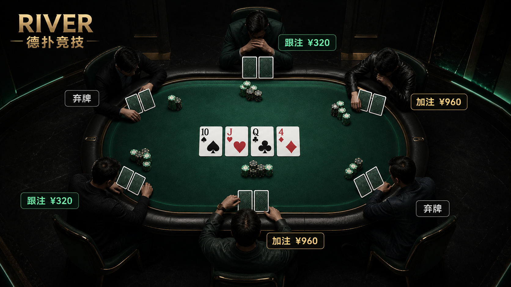

# RIVER 德扑竞技

## 🎮 在线游玩

**[点击进入 RIVER 德扑竞技 →](https://river-poker-table-cn.xty-811811.chatgpt.site)**

无需下载或安装，打开浏览器即可与 AI 对战。游客可直接游玩并保存本机记录；登录后可同步账号手牌记录。

GitHub 仓库右侧 **About → Website** 也提供同一个试玩入口。

一款中文德州扑克 Web 应用：你与 5 名 AI 对手同桌竞技，从翻牌前一路进行到河牌摊牌，直到一名玩家赢得全部筹码。包含沉浸式牌桌、行动倒计时、自动结算，以及可回看的手牌记录。



> 当前为单人对战 AI 的模拟游戏。界面的金额、资金流水和充值等入口用于演示，没有真实支付、提现或多人联机服务。

## 功能

- **完整对局流程**：随机洗牌、轮换庄位、大小盲注，以及翻牌前 / 翻牌 / 转牌 / 河牌四轮下注。
- **下注与结算**：弃牌、过牌、跟注、加注、全下，处理最小加注、短码全下、主池与边池、平分底池和未跟注筹码退回。
- **不同风格的 AI**：结合牌力、抽样胜率、位置、底池赔率和激进程度决定行动，无需大模型 API 或 API Key。
- **锦标赛模式**：6 人各持有 2,000 筹码，总筹码 12,000；初始盲注 20 / 40，每 4 手翻倍，大盲最高 640。
- **牌桌交互**：15 秒行动倒计时；超时自动过牌或弃牌；提供可开关音效和适配小屏幕的布局。
- **记录与复盘**：查看手牌、公共牌、盈亏、行动时间线和底池分配，并根据记录展示近 7 天收益。
- **本机保存与账号同步**：未登录时通过 `localStorage` 保存最近 100 条记录；接入托管平台身份认证和 D1 后，可按账号同步，失败时保留本机待同步记录。

## 技术栈

| 层级 | 技术 |
| --- | --- |
| 界面 | React 19、TypeScript、Tailwind CSS 4、自定义 CSS |
| 应用框架 | vinext（Next.js App Router 兼容层）、Vite 8 |
| 服务端运行环境 | Cloudflare Workers |
| 数据存储 | Cloudflare D1、Drizzle ORM |
| 托管集成 | Sites Vite 插件、平台提供的 ChatGPT 登录身份 |
| 检查 | ESLint、Node.js 内置测试运行器 |

## 本地启动

### 环境要求

- Node.js **22.13.0 或以上**。
- npm（随 Node.js 安装）。

```bash
git clone https://github.com/Tyyyy-Vv/dezhou_poker.git
cd dezhou_poker
npm ci
npm run dev
```

打开终端打印的本地地址。端口以启动日志为准。

本地无需配置 AI 密钥即可体验牌桌和本机记录。默认没有托管平台的登录身份，因此账号记录接口返回 `401`，界面进入本机演示模式；这是正常行为。直接在本地点击 ChatGPT 登录入口不会自动获得平台登录能力。

### 常用命令

| 命令 | 用途 |
| --- | --- |
| `npm run dev` | 启动本地开发服务 |
| `npm run build` | 构建应用，输出到 `dist/` |
| `npm run start` | 启动构建产物的预览服务，需先构建 |
| `npm run lint` | 执行 ESLint 检查 |
| `npm test` | 先构建，再运行服务端 HTML 和关键源码结构检查 |
| `npm run db:generate` | 根据 `db/schema.ts` 生成数据库迁移 |

现有测试覆盖首页服务端渲染与部分关键结构，尚未穷尽下注规则、边池算法和浏览器交互场景。

## 如何体验

1. 进入牌桌，等待轮到自己的座位。
2. 根据当前下注选择弃牌、过牌、跟注、加注或全下。
3. 本手结束后自动结算并开始下一手；最终决出赢得全部筹码的冠军。
4. 在账户与牌局记录界面查看已完成手牌，打开记录查看行动时间线。
5. 在支持登录的托管环境中，使用「登录并同步本机记录」将本机历史同步到账号。

当前进行中的牌局状态保存在浏览器内存中，刷新页面会重新开始比赛；已完成并保存的手牌记录可继续查看。清除浏览器站点数据会删除本机记录。

## 账号记录与部署配置

### 数据库

`.openai/hosting.json` 声明 D1 绑定名 `DB`；`vite.config.ts` 配置本地 Cloudflare 绑定模拟，`db/index.ts` 通过 `env.DB` 连接数据库。

- 数据表：`poker_hand_histories`。
- 初始迁移：`drizzle/0000_romantic_madame_hydra.sql`。
- 记录按服务端登录用户 ID 隔离，以用户 ID 和客户端手牌 ID 去重。
- `GET /api/hand-history` 读取当前账号最近 100 条手牌。
- `POST /api/hand-history` 接收 `{ "records": [...] }`，每次最多 100 条；字段结构见路由中的 `IncomingHand`。

`npm run db:generate` 只生成迁移文件，不会自动应用迁移。启用云端记录前，需要在目标 D1 数据库执行仓库中的 SQL 迁移。

### 登录和托管

当前在线版本已部署到 **Sites / Cloudflare Workers**，通过上方「在线游玩」链接访问；GitHub 托管源码并提供试玩入口。项目包含账号记录 API 和 D1 数据库，**不是可直接部署到 GitHub Pages 的纯静态站点**。

目前 GitHub 推送不会自动触发 Sites 发布；游戏代码更新后，需要通过 Sites 发布流程部署新版本。

在支持的托管环境中，登录入口 `/signin-with-chatgpt`、退出入口 `/signout-with-chatgpt` 和 `/callback` 由平台接管。`app/chatgpt-auth.ts` 读取平台注入的身份请求头；应用自身不实现 OAuth 流程。

部署或迁移到自己的环境时，需要：

1. 为目标环境配置 D1 数据库及 `DB` 绑定，并应用 SQL 迁移。
2. 将 `.openai/hosting.json` 中现有的 `project_id` 替换为自己的 Sites 项目信息；该值是原项目配置，不是可复用的账号凭据。
3. 配置可信的认证入口与身份注入。如果改用其他平台，需要相应替换认证实现，并确保外部请求不能伪造应用所信任的身份头。
4. 使用目标平台的构建和发布流程发布应用。本仓库没有通用的 `deploy` 脚本，也没有手写的 `wrangler.jsonc`。

## 项目结构

```text
app/
  page.tsx                    # 牌桌、游戏逻辑、AI、账户与记录界面
  globals.css                 # 页面样式与响应式布局
  layout.tsx                  # 全局布局及分享元数据
  chatgpt-auth.ts             # 托管平台身份读取与登录链接
  api/hand-history/route.ts   # 账号手牌记录 API
db/
  index.ts                    # D1 / Drizzle 连接
  schema.ts                   # 手牌记录数据模型
drizzle/                      # 数据库迁移及元数据
worker/index.ts               # Cloudflare Worker 入口
public/                       # 图标和项目预览图
tests/rendered-html.test.mjs   # 渲染与结构检查
examples/d1/                  # 保留的 D1 示例，不是主应用路由
.openai/hosting.json          # 托管项目与资源绑定声明
vite.config.ts                # vinext、Sites、Cloudflare 开发构建配置
```

## 当前边界

- 游戏逻辑和 AI 在客户端执行，尚未实现服务端权威对局、真人匹配或反作弊。
- 资金流水与部分无历史记录时的展示内容为样例；实际完成的手牌记录由对局生成。
- 云端记录依赖可用的登录身份、D1 绑定和已应用的迁移；本机模式可独立体验。
- 仓库尚未指定开源许可证；公开可见不等于已授予开源使用许可。
